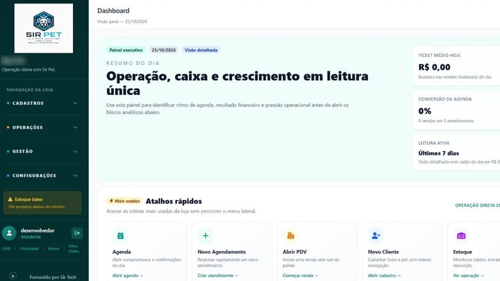
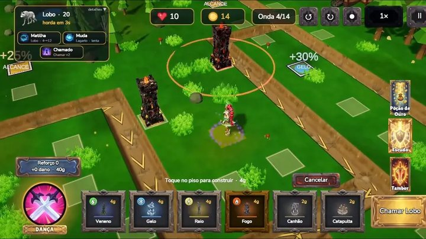
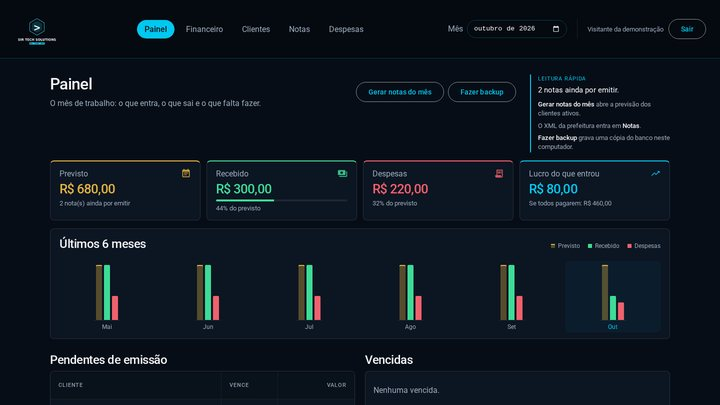
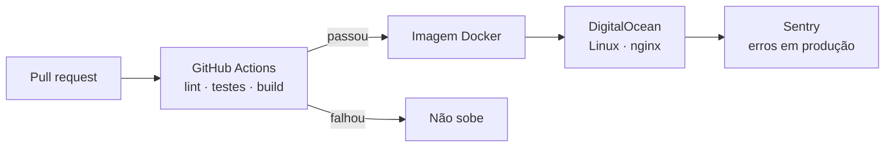

<picture>
  <source media="(prefers-color-scheme: dark)" srcset="assets/header-dark.svg">
  <source media="(prefers-color-scheme: light)" srcset="assets/header-light.svg">
  
</picture>

Sou desenvolvedor full stack e fundador da [Sir Tech Solutions](https://sirtechsolutions.com.br). Faço os sistemas da empresa do banco de dados ao deploy e continuo cuidando deles depois que entram no ar. Hoje são dois sistemas usados todo dia por clientes e um jogo na Google Play.

## No ar

<table>
<tr>
<td width="50%" valign="top">

**SirBarber** · `em produção`

Agendamento online e assinaturas com cobrança recorrente pelo Asaas (PIX, cartão e webhooks). Roda numa barbearia desde julho de 2026, com cerca de 220 agendamentos por mês. A versão multiempresa já tem WhatsApp Cloud API e mais de 880 testes automatizados.

Node.js · TypeScript · Express · Prisma · PostgreSQL · React
</td>
<td width="50%" valign="top">

**Sir Pet** · `em produção`

ERP para pet shop: PDV, estoque, contas a pagar, dashboard financeiro e agenda de banho e tosa, com os dados de cada loja separados.

Python · Django · PostgreSQL · Celery
</td>
</tr>
<tr>
<td width="50%" valign="top">

**Shardspire** · `acesso antecipado`

Tower defense 3D que fiz em Unity. No Duelo, os dois jogadores recebem a mesma horda e mandam monstros para o tabuleiro do outro. Tem Ranqueada online, progresso na nuvem, compras no app e versões em português, inglês e espanhol.

Unity · C# · Unity Gaming Services · Google Play Billing
</td>
<td width="50%" valign="top">

**SirTech Manager** · `open source`

Controla clientes, notas fiscais e despesas da minha empresa e importa o XML da nota. 110 testes da API com Testcontainers (90,5% de cobertura), 114 testes da tela e testes de ponta a ponta com Playwright.

Java 21 · Spring Boot · Angular · PostgreSQL · Flyway
</td>
</tr>
</table>

Também fiz o **Sistema GCM**, que digitaliza registros e relatórios de guardas municipais, com controle de acesso por perfil e um app nativo de botão do pânico ligado à central. Rodou por 6 meses na AWS e foi apresentado ao comando de duas Guardas Civis Municipais. O software tem registro no INPI.

## O que já quebrou em produção

Sistema no ar ensina mais que tutorial. Alguns problemas reais e como resolvi (clique para abrir):

<b>Dois clientes conseguiam reservar o mesmo horário</b>

 

Duas requisições chegavam quase juntas e as duas viam o horário como livre. Passei a travar a linha no PostgreSQL com <code>SELECT ... FOR UPDATE</code> dentro da transação e, onde não existia linha para travar, usei <i>advisory lock</i>. O mesmo ajuste acabou com o crédito de plano sendo usado duas vezes.

<b>Pagamento confirmado pelo Asaas não chegava ao sistema</b>

 

O webhook às vezes chegava atrasado ou falhava no meio do processamento, e a assinatura ficava sem baixa. O aviso de pagamento passou a entrar numa fila e, se der erro, é processado de novo.

<b>Uma migration travou no meio do deploy</b>

 

Uma migration do Prisma parou no meio e bloqueou os próximos deploys. Recuperei o estado do banco e concluí a migration sem tirar o sistema do ar.

## Como o código chega ao ar

Nada vai para produção sem lint, testes e build passando.

## Stack

<picture>
  <source media="(prefers-color-scheme: dark)" srcset="assets/stack-dark.svg">
  <source media="(prefers-color-scheme: light)" srcset="assets/stack-light.svg">
  
</picture>

No dia a dia uso Cursor e Claude Code em modo agente: eu defino o escopo, divido em etapas, valido com testes e decido o que vai para produção.

## Formação

- Engenharia de Software · Anhanguera (conclusão prevista em dez/2027)
- MBA em Gestão da Qualidade e Produtividade · UNIP
- Tecnólogo em Gestão Pública · UNIP

Há 8 anos também sou Guarda Civil Municipal. De lá vem o hábito de decidir sob pressão e de tratar dados sensíveis com cuidado.

São Roque, SP · disponível para presencial, híbrido ou remoto
